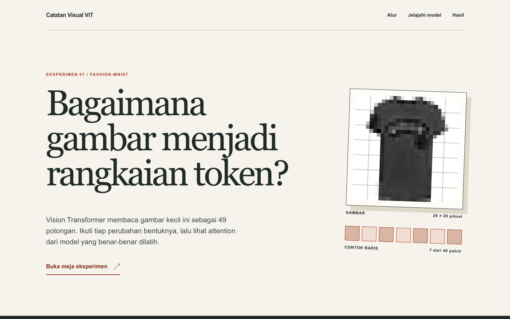

# Catatan Visual ViT

Vision Transformer kecil yang ditulis dengan operasi dasar PyTorch, dilatih dari nol pada Fashion-MNIST, lalu dijelaskan lewat web interaktif berbahasa Indonesia. Proyek ini dibuat sebagai latihan memahami alur ViT dan sebagai portfolio yang dapat diperiksa ulang.



## Hasil eksperimen ini

| Model | Akurasi uji | Parameter | Epoch checkpoint terbaik | Waktu training |
| --- | ---: | ---: | ---: | ---: |
| ViT kecil | 86,05% | 72.074 | 9 | 4 menit 26 detik |
| CNN kecil | 89,72% | 220.234 | 10 | 3 menit 29 detik |

Kedua model memakai split train dan validasi yang sama, batch 128, AdamW dengan learning rate 0,0003, dan batas 10 epoch. Angka berasal dari satu run per model dengan seed 42 pada CPU lokal. Ini bukan klaim bahwa satu arsitektur selalu lebih unggul. Riwayat tiap epoch dan confusion matrix disimpan dalam `artifacts/*_metrics.json` saat training; ringkasannya juga ada dalam data web.

## Mulai dari web

Web memakai keluaran model yang sudah diekspor. Anda bisa menjalankannya tanpa melatih ulang model.

```bash
cd web
npm install
npm run dev
```

Buka alamat lokal yang dicetak Vite. Pilih satu dari sepuluh gambar uji, lalu ganti token yang bertanya, lapis encoder, dan head attention. Kisi kiri menunjukkan patch 4 × 4; kisi tengah menunjukkan bobot dari satu query ke 49 patch. Warna diskalakan ulang untuk tiap pilihan. Angka bobot tetap ditampilkan agar dua peta tidak dibandingkan hanya dari warna.

## Latih ulang dari nol

Butuh Python 3.10+, PyTorch, TorchVision, dan koneksi internet saat Fashion-MNIST pertama kali diunduh.

```bash
python3 -m venv .venv
source .venv/bin/activate
python -m pip install -e .
python -m unittest discover -s tests -v
python -m vit_scratch.train --model vit
python -m vit_scratch.train --model cnn
python -m vit_scratch.export_demo
```

Perintah training menyimpan checkpoint dan metrik di `artifacts/`. Perintah ekspor memperbarui `web/public/data/demo.json` dengan sepuluh contoh dari data uji resmi. Folder dataset, checkpoint, dan keluaran build tidak disimpan dalam repositori. Ekspor web disimpan agar demo dapat dibuka langsung.

## Bagaimana model bekerja

1. `patchify()` memecah gambar `[1, 28, 28]` menjadi 49 patch berisi 16 piksel.
2. Proyeksi linear menghasilkan 49 token berlebar 64. Token kelas dan posisi yang dipelajari membuat urutannya `[50, 64]`.
3. Dua encoder block menghitung attention empat head, residual, dan MLP.
4. Token kelas terakhir menghasilkan sepuluh logit. Cross-entropy dipakai saat training; softmax dipakai untuk menampilkan probabilitas.

Lapisan ViT dan loop training ditulis sendiri di atas tensor dan autograd PyTorch. Tidak ada pretrained weights, `nn.MultiheadAttention`, atau encoder siap pakai. Model kecil ini sengaja berbeda ukuran dari ViT pada [paper aslinya](https://arxiv.org/abs/2010.11929), yang menekankan pretraining berskala besar.

Mulai belajar dari [jalur belajar](docs/learning-path.md). Untuk penjelasan kode dari dataset sampai web, baca [panduan end-to-end](deep-dive/vision-transformer-2026-09-27.md) yang disusun dengan kerangka `$antivibe`.

Arah editorial dan alasan visualnya tercatat di [catatan desain](docs/design-notes.md).
Hasil pemeriksaan visual, copy, aksesibilitas, dan kontrol tercatat di [audit kualitas](docs/quality-audit.md).

## Struktur proyek

- `src/vit_scratch/`: dataset, ViT, CNN pembanding, training, dan ekspor data web.
- `web/`: situs Vite statis dengan penjelasan dan kontrol interaktif.
- `tests/`: tes bentuk tensor, gradien, langkah training, dan pemeriksaan browser.
- `docs/` serta `deep-dive/`: latihan dan penjelasan end-to-end.

Tes browser opsional memakai Playwright. Setelah `npm run build` dan `npm run preview` di folder `web`, jalankan:

```bash
python -m pip install -e '.[browser]'
python -m playwright install chromium
python tests/browser_smoke.py
```

## Batas interpretasi

Web menampilkan rekaman inferensi dari sepuluh gambar yang dipilih secara deterministik: contoh uji pertama pada tiap kelas. Ini bukan sampel acak yang mewakili seluruh dataset. Peta attention memperlihatkan bobot antar-token pada satu head, bukan bukti bahwa suatu patch menyebabkan prediksi. Lihat [Attention is not Explanation](https://arxiv.org/abs/1902.10186) untuk pembahasan batas tersebut. Dataset dan label berasal dari [Fashion-MNIST](https://github.com/zalandoresearch/fashion-mnist).
